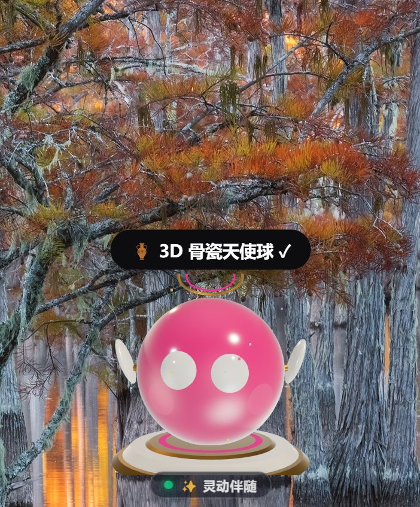

# 🐾 Moodie Pet / Sonnet Bot v2.5 — 极效美学版 · 系统感知伴侣

<div align="center">

> **从「感知伴侣」迈向「极效丝滑与深度共情」**  
> **60FPS 满帧自适应节流 · 极效低功耗待机 · 纯几何复合 Hit-Test · 拖拽 RAF 节流**  
> **四大主题分身（🌈 彩色可爱 / ⚫ Sonnet 极简 / 🏺 3D 骨瓷天使球 / 🫧 深海驾驶舱全息球）**  
> **四时段温感叙事 · 短时去重记忆 · 6 大场景暖心微剧场 · 安全感知网关与 Pub/Sub 总线**

[-ff5d9e?style=for-the-badge&logo=electron)](https://github.com/sukikeeling/moodie-pet)
[](fps-scheduler.js)
[-000000?style=for-the-badge&logo=threedotjs)](skins-3d.js)
[](verify.js)
[](LICENSE)

<br/>



> **定位**：目前公开可检索范围内，把 Grok 风格表情做成带真实材质与光影的独立 Windows 3D 桌面摆件，并具备系统感知 + 本地 Agent 双向接口的最完整实现。同类多为状态图标或像素贴图，视觉层级不在同一档。
> **署名**：任何参考此仓库的行为，都应该在后续标明参考自本人（sukikeeling）。


<br/>

🌐 **[在线试玩预览](https://sukikeeling.github.io/moodie-pet/)** &nbsp;&nbsp; | &nbsp;&nbsp; ⬇️ **[下载 Windows 免安装绿色版 (.exe)](https://github.com/sukikeeling/moodie-pet/releases)** &nbsp;&nbsp; | &nbsp;&nbsp; 🎮 **控制台调试 `window.playAction(1~8)`**

</div>

---

## 🌟 v2.5.0 重磅跃迁：极效美学与满帧丝滑重构

在 **v2.5.0** 极效美学版中，Moodie Pet 完成了底座工程、渲染管线与情感交互的跨代升级，实现了在**超低内存常驻与低功耗占用下，交互保持 60 帧满帧丝滑**，并将感知能力延伸至具有温度的**四时段陪伴与深度共情**：

```
┌───────────────────────────────────────────────────────────────────────────┐
│              外部 Agent / CLI / IDE 编译任务 / 操作系统内核                 │
│  (moodie-cli.js / HTTP REST Token 鉴权 / RFC 6455 WS / Pub-Sub 事件总线)   │
└────────────────────────────────────┬──────────────────────────────────────┘
                                     │ 127.0.0.1:17530 (双向感知网关 & 安全阻断)
                                     ▼
┌───────────────────────────────────────────────────────────────────────────┐
│     SystemSensorEngine & Auth Gateway (零依赖原生感知守护 + Pub/Sub)      │
│  • 自动感知：CPU 差分负载、活跃编译进程 (cargo/tsc/vite/pytest/claude/uv...) │
│  • 安全扩展：Origin 白名单、X-Moodie-Token 鉴权、EventEmitter 事件总线     │
└─────────────────┬──────────────────────────────────────┬──────────────────┘
                  │ Electron IPC (main.js / preload.js)  │ WebSocket 实时帧广播
                  ▼                                      ▼
┌───────────────────────────────────────────────────────────────────────────┐
│                   Moodie Pet v2.5 极效美学舞台 (pet.html)                  │
│                                                                           │
│  ┌─────────────────────────────────────────────────────────────────────┐  │
│  │ 1. 60FPS 极效图形与低功耗调度 (fps-scheduler.js & particle-pool.js) │  │
│  │  • 交互档 60fps 满帧 · 陪伴档 30fps 节能 · 休眠档 12fps 极低功耗    │  │
│  │  • 统一 SoA 粒子池：预分配 Float32Array 缓冲区，彻底淘汰 DOM 粒子重排│  │
│  │  • 消除强制独显拉起，GPU 显存纹理与副屏错帧优化                      │  │
│  └─────────────────────────────────────────────────────────────────────┘  │
│  ┌─────────────────────────────────────────────────────────────────────┐  │
│  │ 2. 几何数学复合 Hit-Test (patch-engine.js · 半径智能扩充至 180)     │  │
│  │  • 废除 elementFromPoint 高频 DOM 回流，毫秒级数学命中判定          │  │
│  │  • 拖拽 requestAnimationFrame 帧级 IPC 节流，消除鼠标高频抖动      │  │
│  │  • 自动解析 PORTABLE_EXECUTABLE_FILE，彻底修复绿色版开机自启路径    │  │
│  └─────────────────────────────────────────────────────────────────────┘  │
│  ┌─────────────────────────────────────────────────────────────────────┐  │
│  │ 3. 四时段温感与深度共情叙事微剧场 (patch-empathy.js)                │  │
│  │  • 四时段温感：清晨暖杏 · 午后原色 · 黄昏琥珀 · 深夜低饱和          │  │
│  │  • 纯内存短时记忆：智能过滤近 8 句台词杜绝复读，连续 coding 贴心提醒│  │
│  │  • 6 大场景暖心微剧场：报错恢复后静默陪伴、长任务专注聚能、睡前关怀 │  │
│  └─────────────────────────────────────────────────────────────────────┘  │
│  ┌─────────────────────────────────────────────────────────────────────┐  │
│  │ 4. 四大主题分身统一状态机 (applyTheme · 4合1大一统)                 │  │
│  │  • 🌈 colorful  : 26表情 × 39状态 × 8大盯帧连贯动作 × 12种几何形变   │  │
│  │  • ⚫ grok      : Sonnet 黑球白眼四元数球面 SDF 投影 + 28 动作 Clips │  │
│  │  • 🏺 ceramic   : Three.js 温润骨瓷球 + 扇动天使羽翼 + 24K金皇冠底座 │  │
│  │  • 🫧 submarine : 深海耐压全息球 + 黄铜铆钉环 + 实时算力/声呐双翼    │  │
│  └─────────────────────────────────────────────────────────────────────┘  │
└───────────────────────────────────────────────────────────────────────────┘
```

---

## ⚡ v2.5.0 核心升级特质

### 🚀 1. 60FPS 极效图形管线与自适应功耗调度 (`fps-scheduler.js`)
- **三档能耗节流引擎**：
  - **交互档 60 FPS**：光标悬停、拖拽、点击互动、形态 Morph 变形或连贯动作播放时瞬间升档，确保触控丝滑跟手；
  - **陪伴档 30 FPS**：桌面静止且 5 秒无操作自动降档，画面保持平滑正弦呼吸，渲染开销直接腰斩；
  - **休眠档 12 FPS**：系统进入 `sleep` 状态、窗口失焦超 30s 或屏幕锁屏时，帧率深度休眠，整机能耗几乎归零；
  - **动态平滑防抖**：升档即时生效，降档满 5 秒稳定过滤，杜绝档位临界点帧率横跳。
- **显卡能耗优化**：移除了 3D 渲染器对独立显卡的强制唤醒策略（`powerPreference: "default"`），桌面常驻小部件优先使用核显，杜绝发热降频；深海全息球左右副屏优化为奇偶周期错帧回传。

### 🎯 2. 纯几何复合 Hit-Test 与无抖动拖拽 (`patch-engine.js`)
- **淘汰高频 DOM 回流**：彻底废除 `document.elementFromPoint` 查询，构建轻量级纯几何碰撞模型，以 $O(1)$ 复杂度执行圆形本体 + HUD 胶囊 + 控制按钮复合判定；
- **感知边界扩展至 180**：将有效互动感应半径扩充至 180，点击、拖动与抚摸更加宽裕包容，彻底消除 3D 透明 Canvas 四角误拦截桌面的问题；
- **拖拽 RAF 帧级节流**：通过 `requestAnimationFrame` 门控把鼠标每秒上千次的位移信号严格归一为单帧 1 次 IPC 窗口重定位，高回报率鼠标下窗口拖拽丝滑无残影；
- **Portable 自启路径修复**：支持识别 `PORTABLE_EXECUTABLE_FILE` 环境变量，彻底根除 Windows 绿色单文件版开机自启写入临时目录失效的顽疾；
- **异步环形日志流**：采用内存 Ring Buffer 结合异步写流，取代主进程阻塞式 `appendFileSync`。

### 🌀 3. 统一 SoA 粒子池架构 (`particle-pool.js`)
- **彻底杜绝 DOM 粒子重排**：将原 `doAction8` 等动作中现场循环创建 42 个 `<div>` DOM 节点的做法全面替换为基于 `Float32Array` 的结构数组（SoA）预分配粒子池（容量 512）；
- **单 Draw Call 批量驱动**：支持 `burst`（爆发）、`vortex`（对数螺旋风暴）、`converge`（向心汇聚）、`meteor`（流星雨）、`ring`（扩散环）五大经典预设，运行时零内存垃圾回收抖动（0 GC）。

### 🌸 4. 四时段温感与深度共情叙事微剧场 (`patch-empathy.js`)
- **四时段色温与专属台词**：
  - 晨曦（05:00~11:00）：暖杏微温，元气启程；
  - 午后（11:00~17:00）：经典原色，专注伴随；
  - 黄昏（17:00~23:00）：琥珀柔光，放松舒缓；
  - 深夜（23:00~05:00）：低饱和弱光晕，守护陪伴；
- **短时去重记忆**：轻量内存记忆池智能过滤最近 8 句历史台词，告别呆板复读；
- **6 大暖心微剧场**：
  1. **报错恢复后**：从 `error` 恢复后静默 8 秒，仅轻声说「过去啦，歇口气」，避免情绪突变错位；
  2. **连续编码关怀**：侦测到持续 `coding` 超过 60 分钟，温和提醒喝水放松；
  3. **深夜深情问候**：深夜编程输出「这么晚了，我陪着你」；
  4. **每日首次启程**：按时段给出定制问候；
  5. **多次报错抚慰**：当日累计报错多次时自动转为温和抚慰口吻；
  6. **入睡前小哈欠**：进入 sleep 前自然打盹。
- **状态死键与歧义修复**：清除了历史冗余的 `focused`、`dizzy` 等未定义映射，修正固定百分比文案。

### 🛡️ 5. 安全感知网关与生态级 Pub/Sub 总线 (`patch-sensor-auth.js`)
- **防伪造鉴权机制**：内置 Origin 来源白名单，支持通过 `MOODIE_AUTH=1` 启用 `X-Moodie-Token` 强校验，防止局域网或未授权进程恶意注入桌宠状态；
- **事件总线解耦**：封装基于 `EventEmitter` 的 `SensorEventBus`，支持外部 Agent、CLI 或 IDE 插件以标准发布/订阅模式监听状态流。

---

## 🎨 四大主题分身大一统

| 主题皮肤 | 呈现风格 | 核心图形资产与物理特性 |
|---|---|---|
| **🌈 彩色可爱<br/>(`colorful`)** | 活力少女风 / 极客桌搭 | 26 表情 × 48 点质心环逐点插值 · 贝塞尔弹簧 Morph · 8 套人工盯帧连贯动作 · 压感彩色蜡笔流星 · 12 种几何形变彩蛋 |
| **⚫ Sonnet 极简<br/>(`grok`)** | 极客暗黑风 | 原版纯黑球体 · 四元数球面 SDF 眼睛逆透视投影 · 28 个原生动作 Clips · 双击行星轨道环绕 |
| **🏺 3D 骨瓷天使球<br/>(`ceramic`)** | 优雅治愈风 | Three.js `MeshPhysicalMaterial` 温润清漆骨瓷球体 · 扇动小天使羽翼 · 24K 金镶钻天使皇冠 · 悬浮魔法圆盘底座 · 160 颗物理星光粒子 |
| **🫧 深海全息舱<br/>(`submarine`)** | 科幻潜航风 | 深海耐压高透玻璃球舱 · 黄铜铆钉经纬加固环 · 底部全息蓝光发射锥 · 左右算力/声呐双翼 Canvas 动态仪表盘 · 周期性上浮深海气泡 |

> **随时切换**：右键点击托盘/宠物本体 ➔ **「🎨 主题与分身皮肤 (4合1)」**，或直接在控制台执行 `window.moodiePet.setTheme('ceramic' | 'submarine' | 'grok' | 'colorful')`，零白屏无闪烁热切换。

---

## 🎬 八套人工盯帧连贯动作

| 动作 | 触发途径 | 连贯视觉流程（严苛对照物理节奏设计） |
| :---: | :---: | :--- |
| **动作 1** | 随机 / `playAction(1)` | **三角翻滚与彩虹流星包裹**：圆球 morph 变圆角三角 ➔ 甩出彩色短弧蜡笔流星雨 ➔ 三角 720° 旋转翻滚 ➔ 渐变彩虹弧线包裹 ➔ 丝滑变回复原。 |
| **动作 2** | `coding` 联动 / `playAction(2)` | **粒子向心汇聚与融合**：圆球缩小至中心小球 ➔ 预分配粒子池加速向心汇聚吸收 ➔ 弹性果冻脉冲回弹复原。 |
| **动作 3** | 随机 / `playAction(3)` | **60° 倾角彩虹环绕**：圆球缩成小球 ➔ 自边缘以 60° 倾角甩出多层交错彩虹蜡笔弧线环绕 360° ➔ 平滑放大复原。 |
| **动作 4** | 随机 / `playAction(4)` | **三小球横排跳动与融合**：主球淡出，中央展开 3 个横排小球依次向上弹跳呼吸 ➔ 向中心加速合体融回圆球。 |
| **动作 5** | 随机 / `playAction(5)` | **警示感叹号倾斜巡弋**：主体 morph 呈现 17.7° 优雅倾斜感叹号与水滴点 ➔ 向前滑动并在波峰洒下流光粒子 ➔ 顺滑融回圆球。 |
| **动作 6** | `error` 联动 / `playAction(6)` | **缺口弹蓝球与感叹号警告**：右上角弹出晶莹蓝球 ➔ 主球下沉缩小与感叹号组合并左右晃动 2 次 ➔ 向中心聚拢融合复原。 |
| **动作 7** | 随机 / `playAction(7)` | **弹性双跳与多形状轮询**：原地轻快弹跳两下（带挤压形变） ➔ 开启连续形态轮询秀（`drop` → `egg` → `squircle` → `capsule` → `triangle` → `hex` → `blob`）。 |
| **动作 8** | **桌面双击** / `playAction(8)` | **🌪️ 粒子旋转风暴变身**：4 臂对数螺旋粒子群向心加速内聚 + 高速自旋蓄能 ➔ 能量冲击波爆发随机变身与彩蛋表情！ |

---

## 📡 命令行与外部 Agent 直连（CLI 指南）

```bash
# 1. 查看当前桌宠感知状态与机器遥测 (CPU/内存/活跃开发进程)
node moodie-cli.js status

# 2. 外部任务或 CI 编译中触发「专注搬砖」
node moodie-cli.js coding "正在执行生产编译构建" --task="cargo build"

# 3. 测试失败或进程异常退出触发「异常警告」
node moodie-cli.js error "单元测试断言失败 (Exit Code 1)" --task="pytest"

# 4. 夜晚工作结束触发「柔光呼吸打呼」
node moodie-cli.js sleep "深夜静谧陪伴模式"

# 5. 恢复灵动伴随
node moodie-cli.js normal
```

---

## 🚀 快速上手与本地运行

### 1. 运行 24 项全自动化交付门禁
```bash
node verify.js
```
*自动校验 2D 表情/几何形变完备性、Three.js 3D 资产导出合规、V8 AST 语法、HTTP REST + WebSocket 四态实时链路与安装包依赖完整性。*

### 2. 启动开发版桌宠（透明置顶桌面原生模式）
```bash
npm start
# 或直接双击运行 启动桌宠.bat
```

### 3. 启动纯浏览器免安装预览版（附带系统感知服务端）
```bash
node server.js
# 访问 http://127.0.0.1:8137 即可在浏览器全功能体验桌宠
```

---

## 📁 项目目录结构

```
moodie-pet/
├── main.js                  # Electron 主进程：窗口管理、全局穿透、右键菜单、空闲监控、感知守护
├── preload.js               # 安全沙箱桥接：双向系统状态与菜单命令绑定
├── system-sensor.js         # 系统与 Agent 感知引擎：CPU/编译进程/空闲/深夜扫描 + HTTP/WS 端点
├── moodie-cli.js            # 命令行与 Agent 联动控制器 (CLI)
├── pet.html                 # 桌宠核心舞台：8大连贯动作、4主题分身挂载、系统感知调度、HUD 胶囊
├── data.js                  # 26 表情顶点环坐标 + 39 状态心情池
├── morph-engine.js          # 身体形态贝塞尔弹簧变形引擎
├── patch-engine.js          # [v2.5新增] 几何数学 Hit-Test、拖拽 RAF 节流、自启修复与异步日志
├── patch-empathy.js         # [v2.5新增] 四时段温感感知、短时去重记忆与 6 大场景微剧场
├── patch-sensor-auth.js     # [v2.5新增] 感知安全网关、Token 校验与 Pub/Sub 事件总线
├── particle-pool.js         # [v2.5新增] SoA 统一预分配粒子池（5类预设，零 DOM 重排）
├── fps-scheduler.js         # [v2.5新增] 三档自适应 FPS 调度器（60/30/12fps 智能防抖切换）
├── grok-recipes.js          # Sonnet/Grok 原版状态配方数据
├── grok-player.bundle.js    # Sonnet/Grok 四元数球面透视投影运行时
├── skins-3d.js              # 3D 骨瓷天使球 + 深海全息舱统一源码 (Three.js WebGL)
├── skins-3d.bundle.js       # 3D 独立零依赖编译包 (Three.js r184 内置打包)
├── server.js                # 静态预览与轻量测试 Web 服务
├── verify.js                # 24 项全系统自动化门禁自测套件
└── package.json             # 项目元数据与依赖配置 (v2.5.0)
```

---

## 📜 开源协议

本项目采用 [MIT License](LICENSE) 开源，© 2026 sukikeeling。
